

# استديو التعريب — Arabization Studio

**منصة متكاملة لتعريب الألعاب والبرامج وترجمة الملفات والترجمات المرئية**، بواجهة عربية كاملة من اليمين لليسار (والإنجليزية متوفرة).

-0078d4)

### ⬇️ [تحميل أحدث إصدار](https://github.com/baybarssy-source/Arabization_Studio_project/releases/latest)
حمّل ملف التثبيت `*_x64-setup.exe` من قسم **Assets** في صفحة الإصدار وشغّله.

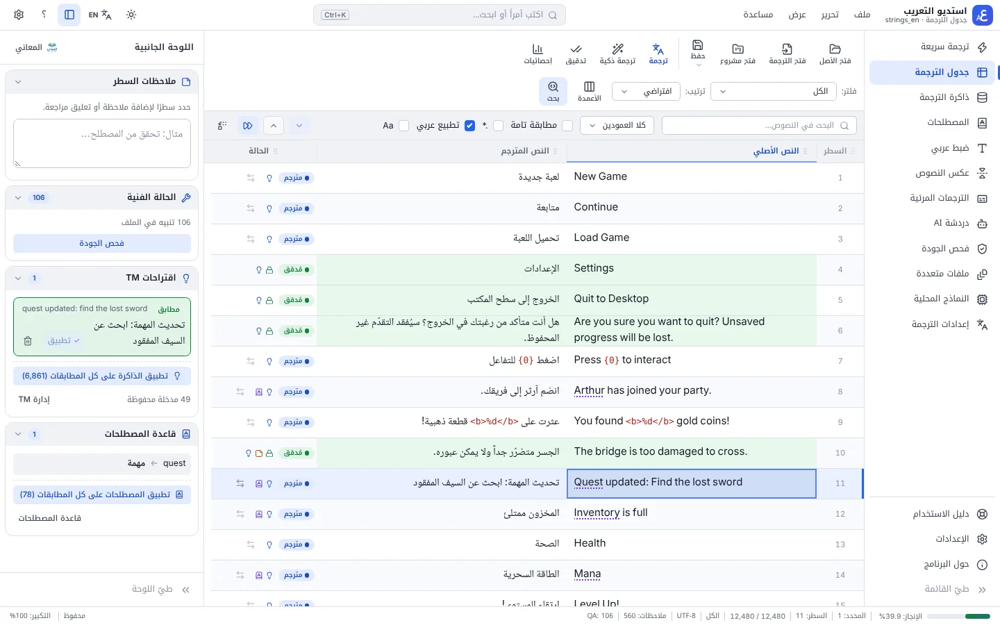

## ماذا يفعل البرنامج؟
افتح ملف نصوص اللعبة أو البرنامج أو الترجمة المرئية، ترجمه بالمحرك الذي تفضّله أو يدوياً، راجعه وافحص جودته، ثم احفظه **بنفس صيغته وترميزه** جاهزاً للاستخدام.

## المزايا الرئيسية
- **جدول ترجمة سريع** يفتح ملفات بملايين الأسطر: TXT وJSON وCSV/TSV وXLSX وPO وXLIFF وSRT/VTT/ASS، مع تراجع غير محدود وبحث واستبدال (تعبيرات نمطية وتطبيع عربي) وفلاتر ومشاريع `.asproj`.
- **ترجمة ذكية** بأكثر من 30 محركاً: Google وDeepL وMicrosoft وGemini وOpenAI وClaude وOpenRouter وGroq وOllama وغيرها — مع **مفاتيح API متعددة** وجدولة آمنة للحصص، وحماية الأكواد والوسوم (`{0}` و`<b>` و`%d`…) ومراجعة لغوية بالذكاء الاصطناعي.
- **ذاكرة ترجمة وقاعدة مصطلحات**: اقتراحات فورية بالمطابقة الضبابية، وتطبيق على كل المطابقات بخطوة تراجع واحدة.
- **عكس النصوص (ArabiFlip v4)** للألعاب التي لا تدعم العربية، مع معاينة «كما في اللعبة».
- **استوديو الترجمات المرئية**: التوقيتات، والإزاحة، وإصلاح التداخل، والتقسيم والدمج، وفحص سرعة القراءة وطول السطر.
- **نماذج محلية** تعمل دون إنترنت (NLLB وArgos وغيرها) وتشكيل النص العربي.
- **فحص الجودة، ضبط عربي، دردشة AI، ملفات متعددة، استيراد تحديث الأصل**، ودليل استخدام مدمج (F1).

## لقطات الشاشة
| | |
|---|---|
| 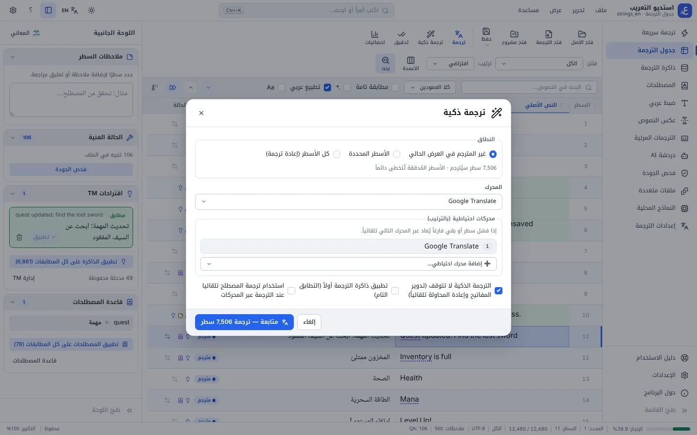 **الترجمة الذكية** | 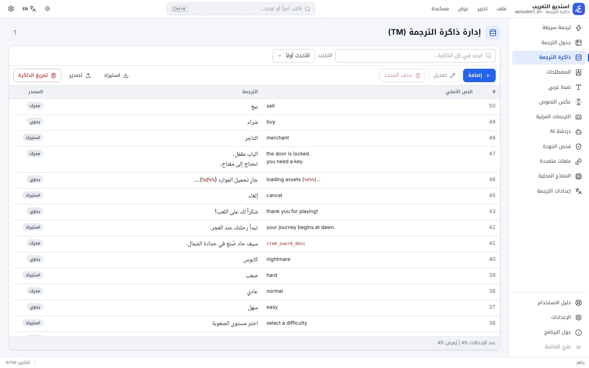 **ذاكرة الترجمة** |
| 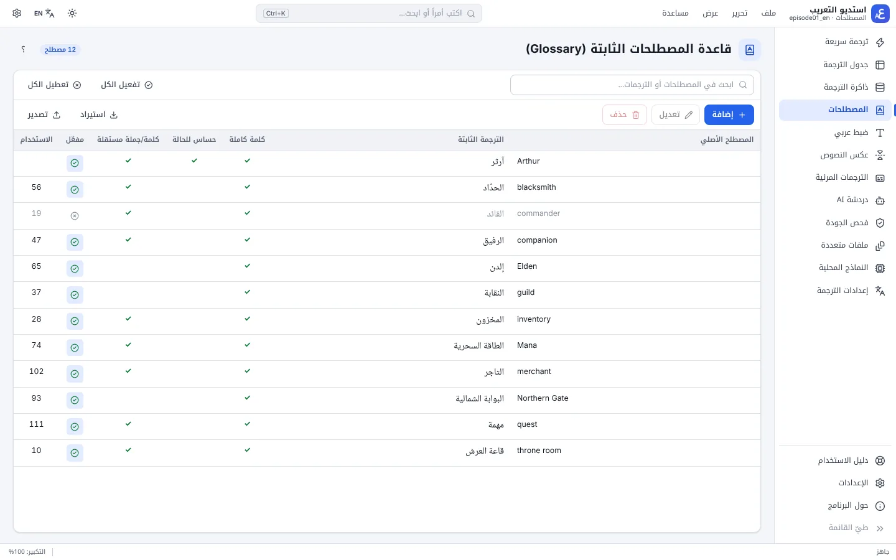 **قاعدة المصطلحات** | 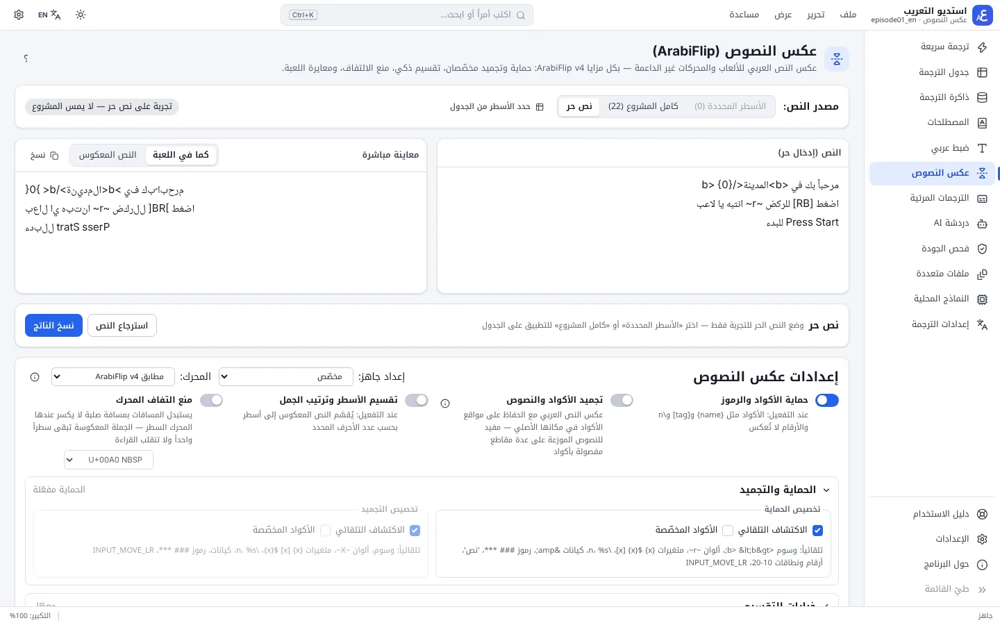 **عكس النصوص (ArabiFlip)** |
| 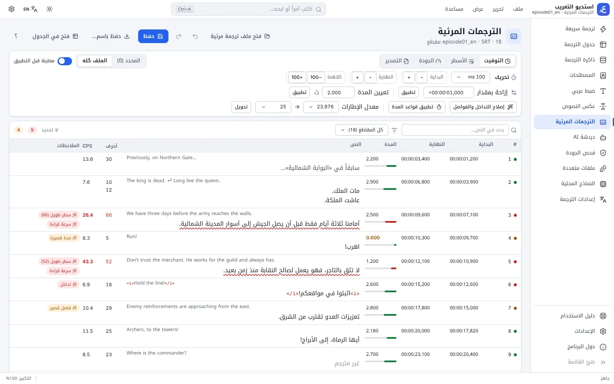 **استوديو الترجمات المرئية** | 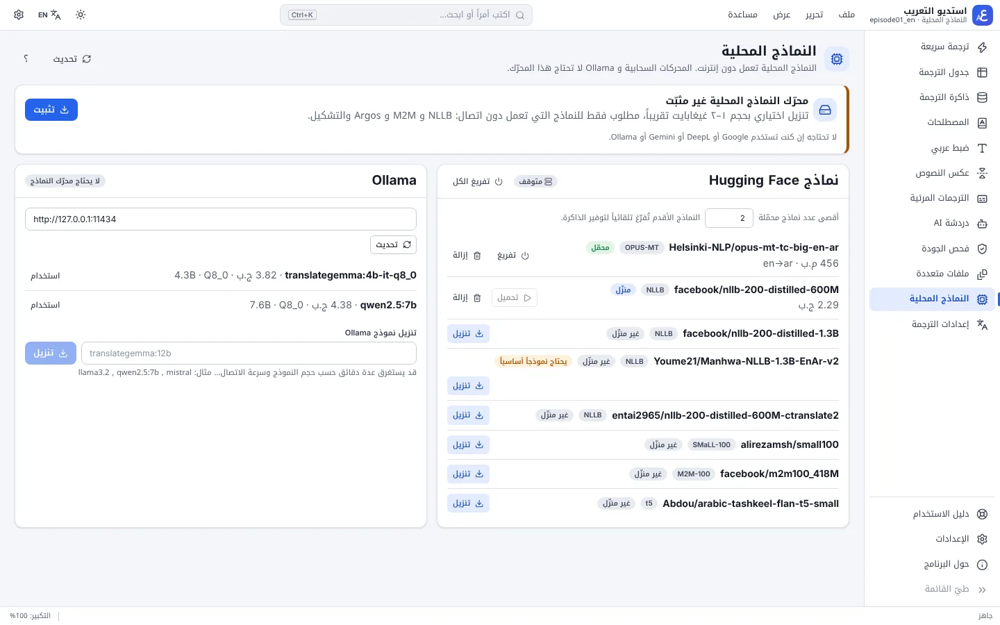 **النماذج المحلية** |
| 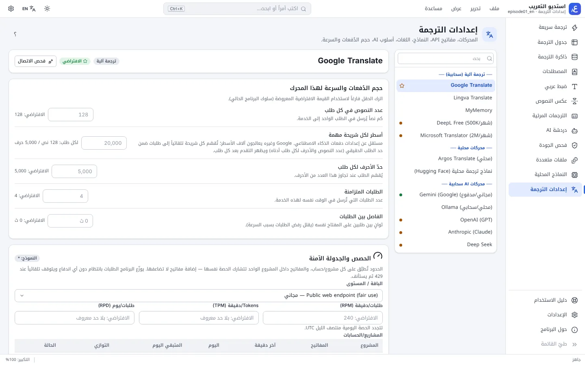 **إعدادات الترجمة والمحركات** | 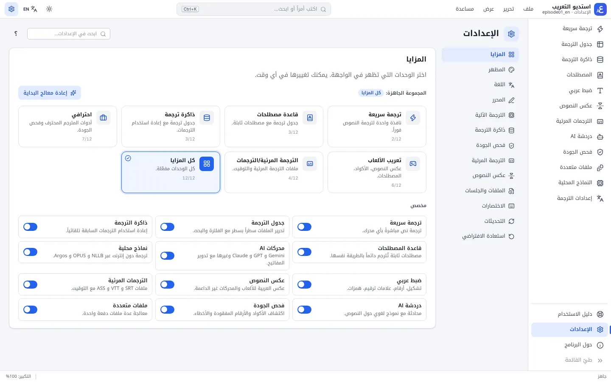 **الإعدادات** |
| 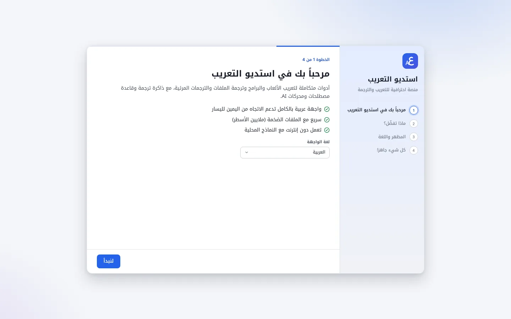 **معالج البداية** | 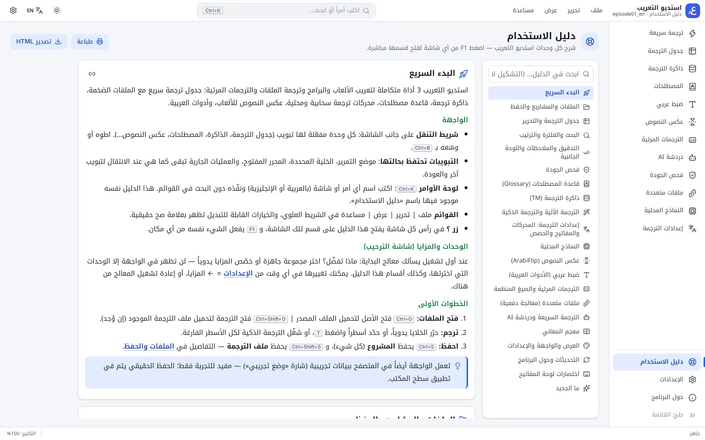 **دليل الاستخدام** |

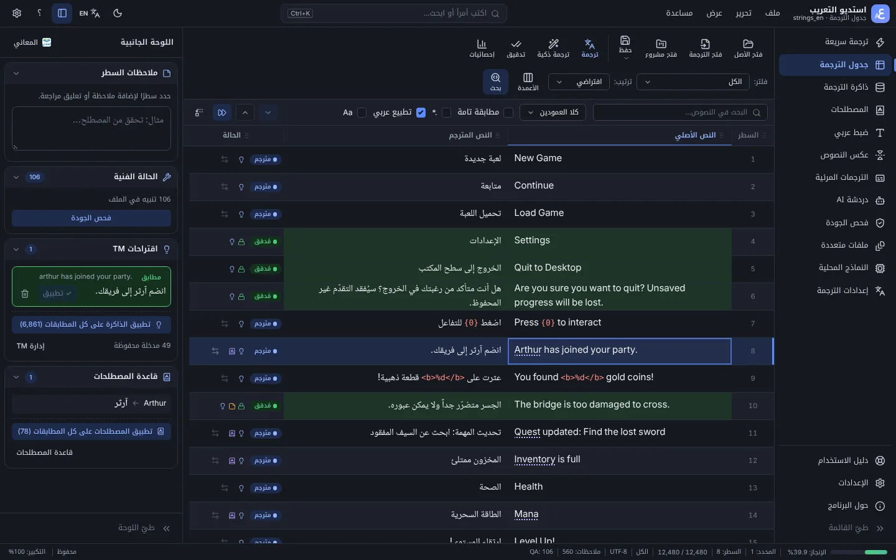

## متطلبات التشغيل
- Windows 10 أو 11 (64-بت). يُثبَّت WebView2 تلقائياً إن لم يكن موجوداً.
- اتصال بالإنترنت للمحركات السحابية فقط؛ النماذج المحلية تعمل دون اتصال (محرّكها تنزيل اختياري من داخل البرنامج، نحو 1–2 غيغابايت).
- مفاتيح API للمحركات التي تحتاجها (Google Translate المجاني لا يحتاج مفتاحاً).

## تحذير SmartScreen عند أول تثبيت
ملف التثبيت غير موقّع بشهادة تجارية، لذلك قد يعرض Windows رسالة «Windows protected your PC». اضغط **مزيد من المعلومات** ثم **تشغيل على أي حال**. التحديثات نفسها موقّعة رقمياً ويتحقق البرنامج من توقيعها قبل تثبيتها.

## التحديثات
يتحقق البرنامج من وجود إصدار جديد عند التشغيل (يمكن إيقاف ذلك من الإعدادات)، فيظهر شريط «يتوفر إصدار جديد» مع **«ما الجديد»**، ويُنزَّل التحديث ويُثبَّت بضغطة واحدة بعد حفظ عملك. ويمكنك التحقق يدوياً من «مساعدة ← التحقق من التحديثات» أو نافذة «حول البرنامج». ملاحظات كل إصدار في [صفحة الإصدارات](https://github.com/baybarssy-source/Arabization_Studio_project/releases).

## التواصل
المصمم: abo3bdoo.sy@gmail.com · [x.com/Abo3bdooS](https://x.com/Abo3bdooS)

---

## English

**Arabization Studio** is an all-in-one Windows app for Arabizing games and software and translating files and subtitles, with a full right-to-left Arabic interface (English UI included).

**[⬇️ Download the latest release](https://github.com/baybarssy-source/Arabization_Studio_project/releases/latest)** — get the `*_x64-setup.exe` installer from **Assets**.

**Key features**
- Fast translation table for huge files (TXT, JSON, CSV/TSV, XLSX, PO, XLIFF, SRT/VTT/ASS), saved back with the same encoding and formatting; unlimited undo, regex find & replace, filters, projects.
- Smart translation with 30+ engines (Google, DeepL, Microsoft, Gemini, OpenAI, Claude, OpenRouter, Groq, Ollama…), multiple API keys with quota-safe scheduling, code/tag protection and AI review.
- Translation memory and glossary with fuzzy suggestions; ArabiFlip v4 text flipping for games without Arabic support; a subtitles studio; offline local models (NLLB, Argos) and diacritization; QA checks, AI chat, batch files and a built-in guide.

**Requirements:** Windows 10/11 64-bit (WebView2 is installed automatically if missing). Internet only for cloud engines.

**SmartScreen:** the installer isn't signed with a commercial certificate, so Windows may warn on first install — choose **More info → Run anyway**. Updates are signed and verified by the app.

**Updates:** the app checks for new versions at startup (can be turned off in Settings), shows the release notes ("What's new") and installs the update in one click. Release notes for every version are on the [Releases](https://github.com/baybarssy-source/Arabization_Studio_project/releases) page.
